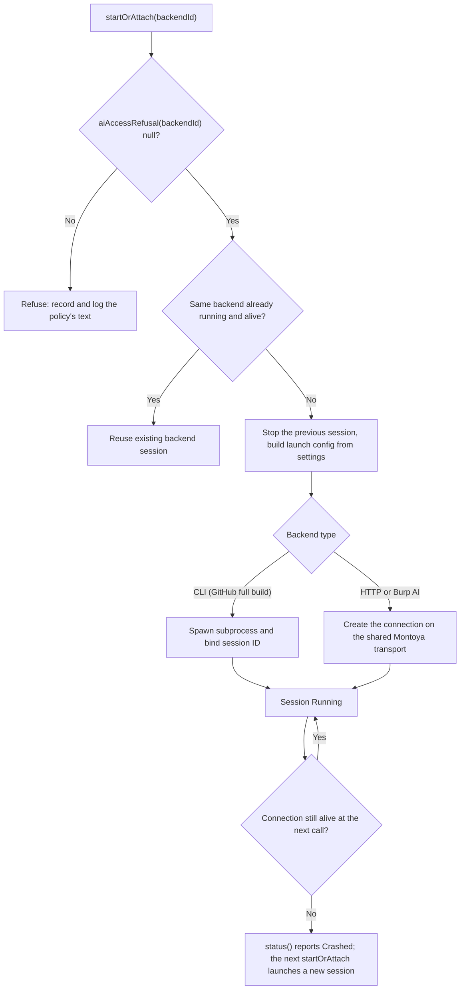
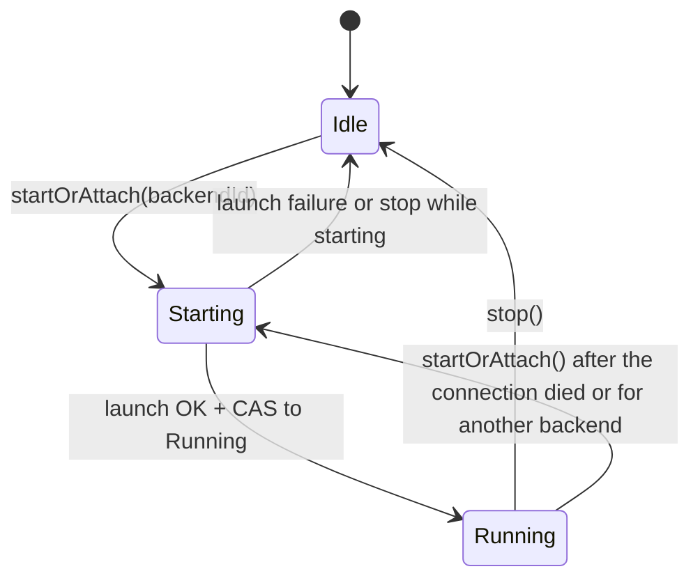
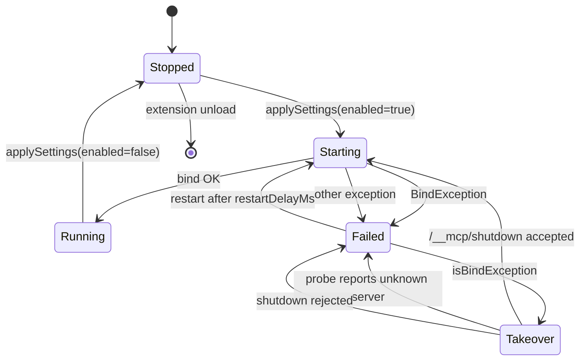

# Supervisor & Backends

The supervisors coordinate backend process lifecycle, health state, and MCP server runtime.

## Agent Supervisor

The `AgentSupervisor` controls backend sessions: HTTP backends and Burp AI in both builds, plus the CLI backends in the GitHub full build.

### Responsibilities

* Start or attach backend sessions.
* Apply the "Use AI" gate to every AI request (see [Use AI Gate](#use-ai-gate)).
* Run health checks on request and expose backend state.
* Start the local Ollama or LM Studio server when the user agrees to it after a chat send finds it unreachable.
* Emit operational events used by diagnostics and audit flows.

### Lifecycle

There is no background health-monitoring loop and no automatic restart in the supervisor: a dead session is reported as `Crashed` and replaced the next time a start is requested. The status pill's health checks are described in [Backends Overview](../backends/overview.md).

### Supervisor State Machine

### Use AI Gate

Which backends need Burp's "Use AI" setting is decided by an injected `AiAccessPolicy` (`com.six2dez.burp.aiagent.spi`), not by a build flag:

* `StoreAiAccessPolicy` is the core default and the BApp Store build's policy. While "Use AI" is off it refuses a request to **every** backend, whatever its id, with: "This build sends AI requests only while Burp's 'Use AI' setting is enabled. Turn it on in Burp's settings to use any AI backend."
* `FullAiAccessPolicy` (`src/full`, registered through `META-INF/services/com.six2dez.burp.aiagent.spi.AiAccessPolicy`, a file only the full JAR carries) refuses only the `burp-ai` backend, with: "Burp AI is disabled in Burp Suite settings. Enable 'Use AI' for extensions, or pick a different backend."

With no provider on the classpath, or with more than one, the extension uses `StoreAiAccessPolicy`, so a packaging error leaves the build stricter, never laxer.

The supervisor applies the policy through two call-site helpers:

* `AgentSupervisor.aiAccessRefusal(backendId: String): String?` returns `null` when a request to `backendId` may start, otherwise the policy's refusal text. It reads `api.ai().isEnabled()` live on every call (an exception reads as `false`) and asks the policy with that value. Once unload has begun it answers "AI request refused: the extension is unloading." instead. `startOrAttach`, `send`, `sendChat`, the chat panel, the status pill, **Test connection** and the scanners (through `refusalForSavedBackend`) all ask it before they start work.
* `AgentSupervisor.aiToolRefusal(): String?` is the refusal for the MCP tools that send AI requests (`ai_analyze` and `ai_passive_scan`, the descriptors with `requiresBurpAi = true`). It asks the policy for the running backend, or else the saved one, and then requires "Use AI" to be on whatever the backend. `McpToolExecutorImpl` calls it on every call before the tool's handler runs, so those two tools return a tool error while "Use AI" is off, in both builds.

The enforcement point is per request, not per session. The supervisor builds the single `MontoyaHttpTransport` with a `ProviderEgressGate` (`backends/http/ProviderEgressGate.kt`) that calls `aiAccessRefusal`. Every HTTP request a backend sends, health checks and readiness probes included, goes through the transport's private `execute`, whose first statement is `MontoyaHttpTransport.requireEgress()`: it asks the gate for the backend the transport view is bound to and throws `AiAccessRefusedException` with the policy's text, before any Montoya call, when the request is refused. Burp AI sends no HTTP request, so `BurpAiBackend` calls the same `requireEgress()` before every `api.ai().prompt().execute`. An unbound transport refuses every request, so a wiring mistake fails closed.

What the user sees while a backend is refused: the status pill reads "AI disabled in Burp", the chat shows the refusal inline, and an AI scanner that is switched on shows "Paused: Use AI is off". See [Burp AI (Built-in)](../backends/burp-ai.md) and [Which Build?](../getting-started/which-build.md).

### Session Management

Each launch gets a unique session ID (`session-{UUID}`) so chat history, diagnostics, and backend state remain correlated.

## MCP Supervisor

`McpSupervisor` manages the MCP server independently from AI backends.

### Features

* Health checks with bounded restart attempts (`DEFAULT_MAX_RESTART_ATTEMPTS = 4`, `DEFAULT_RESTART_DELAY_MS = 2000`).
* Existing-server liveness detection and bounded handover on occupied ports (`DEFAULT_MAX_TAKEOVER_ATTEMPTS = 3`).
* SSE and STDIO transport lifecycle.
* Optional TLS with local loopback trust handling.

### State Machine

### Port Takeover Sequence

1. Bind attempt fails with `BindException`.
2. Supervisor probes `/__mcp/health` on the same host:port.
3. Local mode requires `X-Burp-AI-Agent: mcp` before takeover. External mode deliberately omits the identity header and proceeds on a successful liveness response alone. The supervisor posts `POST /__mcp/shutdown`, waits 1 s, then retries the bind, up to `DEFAULT_MAX_TAKEOVER_ATTEMPTS = 3` times.

   The request carries a `X-Mcp-Takeover-Proof` header, **not** the bearer token: `McpTakeoverProof.forTarget` computes `HMAC-SHA256(key = token, message = "burp-ai-agent/mcp-takeover|v1|<host>:<port>|<10s window>")`, and the server-side `McpTakeoverProof.accepts` validates it in constant time against the current and previous window. The token is used as an HMAC key and never becomes an outbound header value, because `probeExistingServer` cannot establish the port holder's identity — the `X-Burp-AI-Agent` marker is echoable by any process. Under TLS on a loopback bind, the client pins the server's leaf certificate to the one in `tlsKeystorePath` and installs no TLS override at all when no pin can be read, so an unidentified listener cannot complete the handshake.
4. If a local-mode response does not carry the marker, takeover is aborted and the failure surfaces in the UI. In external mode, liveness is intentionally not an identity guarantee; the HMAC proof avoids disclosing the reusable bearer credential. A non-loopback TLS bind is an explicit unsupported takeover case: no pinning override is installed, the existing listener is left running, and the operator must free the port manually before restarting MCP.

## HTTP Backend Circuit Breaker

HTTP model-request connections use `HttpBackendSupport` circuit breakers. Health checks are separate: they go through the same `MontoyaHttpTransport` (and its egress gate) but not through the breaker. NVIDIA NIM and Perplexity check health with a free `GET /v1/models`.

* **Failure threshold** (`CIRCUIT_FAILURE_THRESHOLD`): `5` consecutive failures.
* **Reset timeout** (`CIRCUIT_RESET_TIMEOUT_MS`): `30_000` ms before the breaker moves to half-open.
* **Half-open max attempts** (`CIRCUIT_HALF_OPEN_MAX_ATTEMPTS`): `1` — a single probe decides whether to close or reopen.
* **Retry helper** (`retryDelayMs(attempt)`): `500, 1000, 1500, 2000, 3000`, then `4000` ms for later indices. The current six-total-attempt send loops consume only the first five delays because the sixth failure is terminal.

When the breaker is open the backend fails fast with `"<backend> backend is temporarily unavailable (circuit open). Retry in <n>ms."` Retries inside the wrapper are logged to the [AI Request Logger](../privacy/ai-request-logger.md) as `RETRY` entries with `attempt` and `delayMs` metadata.

The built-in Burp AI backend does **not** route through this wrapper — it relies on Burp's internal error handling.

## Backend Types

### CLI Backends

* Run as subprocesses from configured commands.
* Read stdout/stderr continuously into a bounded buffer for liveness/timeout diagnostics, then parse and deliver the final response through one `onChunk` callback after the process completes.
* Include Gemini CLI, Claude CLI, Codex CLI, Copilot CLI, OpenCode CLI.
* GitHub full build only: they live in `src/full` and the BApp Store build does not contain them.
* **Windows**: npm-installed shims are resolved automatically. The launcher detects `.cmd` siblings for shell script shims and falls back to `cmd /c` wrapping when needed.
* **Output parsing**: Each CLI backend has a dedicated output parser that strips metadata, status lines, and prompt echoes from raw stdout to extract the AI response.

### HTTP Backends

* Connect to HTTP APIs of running servers.
* Optionally auto-start local services (provider-dependent).
* Include Ollama, LM Studio, NVIDIA NIM, Perplexity, Anthropic, and Generic OpenAI-compatible.

## Failure Handling

* **Launch failure**: `startOrAttach` returns to `Idle` and records the error (`lastStartError()`); usually a config, auth or command error.
* **Dead session**: `status()` reports `Crashed` and a send fails with "Session is not alive"; the next start launches a new session. Nothing restarts it automatically.
* **Refused request**: an `AiAccessRefusedException` is a policy outcome, not a connection failure: it is never retried and never counted by a circuit breaker.

## Diagnostics

Backend diagnostics include:

* process exit code,
* last stdout/stderr lines,
* launch configuration details,
* retry events with attempt number, backoff delay, and failure reason (logged to [AI Request Logger](../privacy/ai-request-logger.md)).

Use Burp's extension output/errors tabs and the **AI Logger** tab for investigation.

## Trace ID Propagation

The `AgentSupervisor.send()` and `sendChat()` methods accept an optional `traceId` parameter. If not provided, a trace ID is auto-generated (`agent-turn-{UUID}` or `chat-turn-{UUID}`). This trace ID is attached to all log entries for the operation (prompt, response, error), enabling end-to-end correlation in the AI Request Logger.
