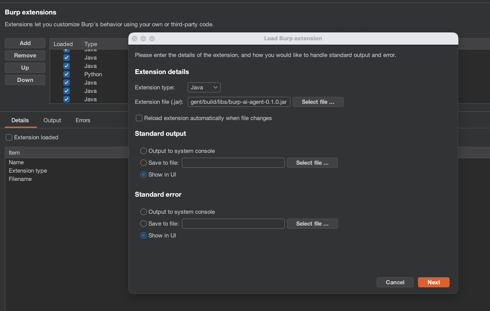
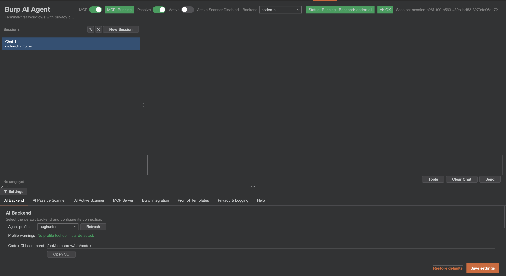

# Installation

## Prerequisites

1. **Burp Suite 2026.2 or newer**, Community or Professional. The current source compiles against Montoya API `2026.2` and uses its scan-check interfaces.
2. **Java 21** for building from source.

> Recent Burp versions include bundled Java runtime for extension execution. Separate Java is mainly needed for local builds.


MCP TLS certificate generation launches the `keytool` binary from the active Java runtime. Use the documented Java 21 toolchain (or the runtime bundled with a compatible Burp build) and ensure `keytool` is present; the current project does not establish a blanket Java 8–25 compatibility guarantee.


## Install Path

There are two builds: the **BApp Store build** and the **GitHub full build**. [Which Build?](which-build.md) explains what each contains and what it needs from Burp.




Custom AI Agent is not listed in the BApp Store yet: the BApp Store build is going through PortSwigger's review in [extension-portal#231](https://github.com/PortSwigger/extension-portal/issues/231).


The BApp Store build (`./gradlew bappJar`) holds the 8 extension-native MCP tools and 7 AI backends (Burp AI and six HTTP backends), and sends AI requests only while Burp's "Use AI" setting is enabled for the extension. Until it is listed, download it from GitHub Releases (next tab) or build it yourself (last tab). See [Which Build?](which-build.md).



1. Open [GitHub Releases](https://github.com/six2dez/burp-ai-agent/releases).
2. Download one build. From v1.1.0, every release attaches both:
   * `Custom-AI-Agent-full-<version>.jar`, the GitHub full build, with `Custom-AI-Agent-full-<version>.jar.sha256`;
   * `Custom-AI-Agent-bapp-<version>.jar`, the BApp Store build, with `Custom-AI-Agent-bapp-<version>.jar.sha256`;
   * one `bom.json` (CycloneDX SBOM) for the release.

   [Which Build?](which-build.md) explains which one to pick.
3. Verify the JAR integrity (see [Verify JAR Integrity](#verify-jar-integrity-sha-256)) before loading.


This documentation tracks the current source tree. A tagged release can lag changes on `main`; build from source when you need behavior documented as current-main hardening, and read the release notes before assuming it is present in an older JAR.




1. Clone repository:

```bash
git clone https://github.com/six2dez/burp-ai-agent.git
cd burp-ai-agent
```

2. Build a fat JAR with JDK 21. Each build has its own task:

```bash
# BApp Store build (8 extension-native MCP tools, 7 AI backends)
./gradlew clean bappJar

# GitHub full build (all 59 MCP tools, 12 AI backends)
./gradlew clean fullJar
```

3. Output paths:

```text
build/libs/custom-ai-agent-bapp.jar             # BApp Store build
build/libs/Custom-AI-Agent-full-<version>.jar   # GitHub full build
```

4. (Optional) Generate an SBOM alongside the JAR:

```bash
./gradlew cyclonedxBom --no-configuration-cache
# Output: build/reports/sbom/bom.json
```



## Verify JAR Integrity (SHA-256)

The GitHub release workflow publishes a `.sha256` checksum file (in `sha256sum` format) next to each JAR and one CycloneDX `bom.json` software bill of materials. Verify the JAR before loading it. The examples use the full build; for the BApp Store build, use `Custom-AI-Agent-bapp-<version>.jar` and its `.sha256`:



```bash
# Run in the folder that holds the JAR and its .sha256 file
sha256sum -c Custom-AI-Agent-full-<version>.jar.sha256        # Linux
shasum -a 256 -c Custom-AI-Agent-full-<version>.jar.sha256    # macOS
```



```powershell
Get-FileHash -Algorithm SHA256 Custom-AI-Agent-full-<version>.jar
```



If the two values differ, **do not load the JAR** — re-download from the official release page.

## Load into Burp Suite

Load only one build. Both builds register as **Custom AI Agent**; unload any other copy before you add a JAR (see [Which Build?](which-build.md#load-only-one-build)).

1. Open **Extensions -> Installed -> Add**.
2. Select extension type `Java`.
3. Choose the JAR file.
4. Complete load wizard.



## Verify Installation

Expected indicators:

* extension loads without startup errors,
* the extension appears as **Custom AI Agent** in **Extensions -> Installed**, and its **Custom AI Agent** tab appears in Burp main navigation.

> The extension registers its display name as **Custom AI Agent** to distinguish it from Burp's built-in **Burp AI** provider; that is the name shown in Burp's Extensions list and Suite tab, and the name intended for the still-pending BApp Store listing.

<figure><figcaption></figcaption></figure>

## Runtime Directory

On first start, `~/.burp-ai-agent/` is created:

```text
~/.burp-ai-agent/
├── audit.jsonl
├── bundles/
├── contexts/
├── backends/         # GitHub full build only: drop-in backend JARs
├── cache/            # created on demand by PersistentPromptCache (per project)
├── certs/
│   └── mcp-keystore.p12
├── logs/             # created on demand by the opt-in rolling AI Request Logger
└── AGENTS/
    ├── default          # plain text file whose content names the active profile (no extension)
    ├── pentester.md
    ├── bughunter.md
    └── auditor.md
```

The directory keeps the legacy `burp-ai-agent` name on disk to preserve upgrades for existing users; the product itself is now called **Custom AI Agent**. See [Configuration Directory](../reference/configuration-directory.md) for a per-entry reference.

Custom additions:

* profiles: `~/.burp-ai-agent/AGENTS/*.md` ([Agent Profiles](../user-guide/agent-profiles.md))
* backend plugins (GitHub full build only; the BApp Store build never creates or loads this directory): `~/.burp-ai-agent/backends/` ([Adding a Backend](../developer/adding-backend.md))

## Troubleshooting

* Extension load failure: inspect Burp Errors/Output tabs and Java version.
* Tab missing: ensure extension is enabled.
* Permission errors: ensure write access to `~/.burp-ai-agent/`.

## Next Steps

Continue with [Quick Start](quick-start.md).
