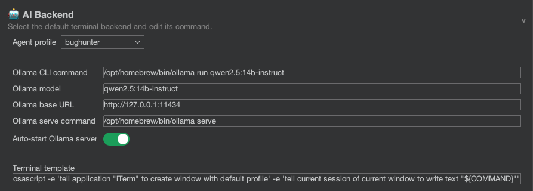
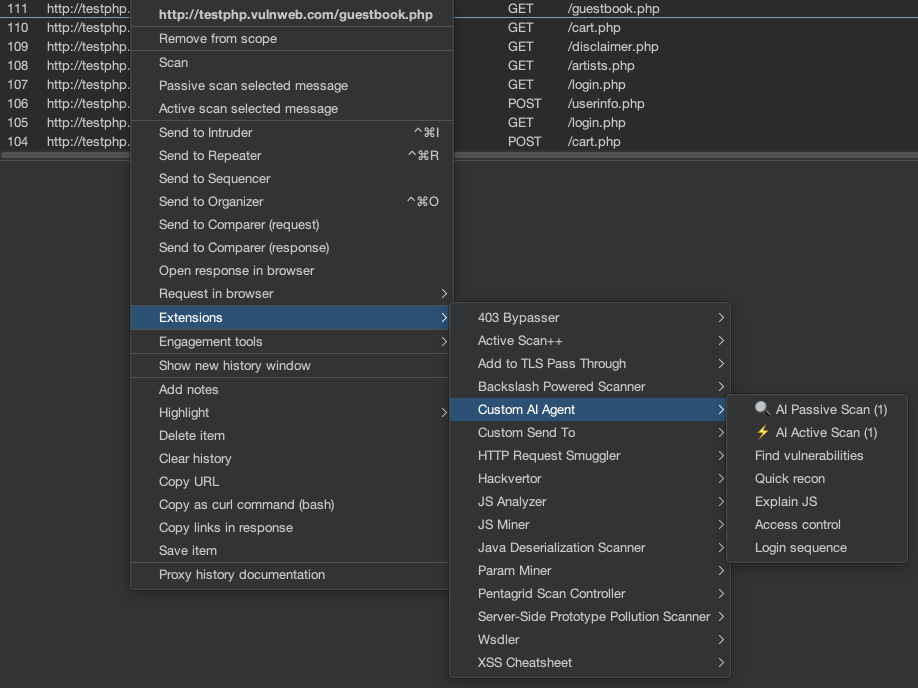
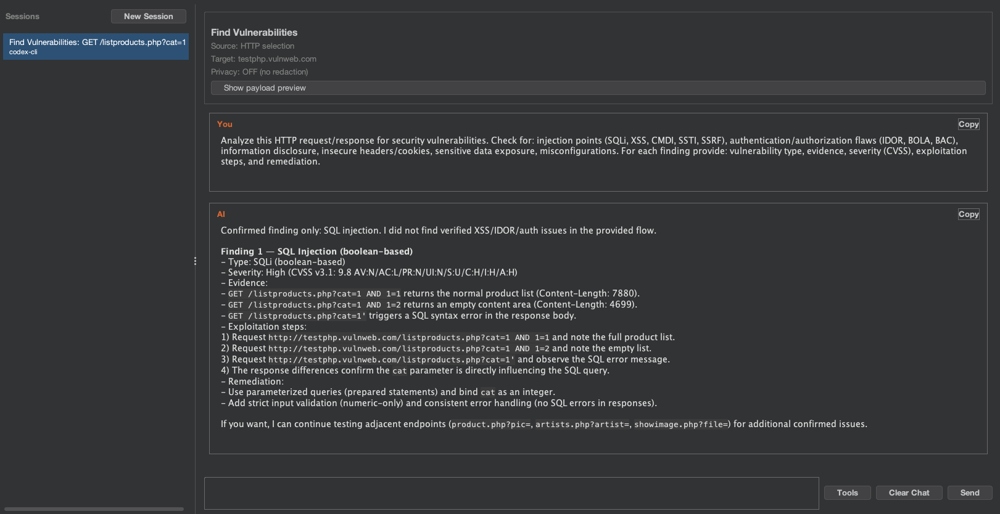
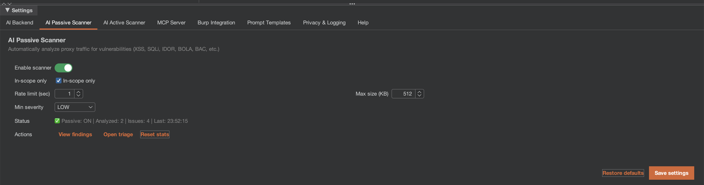

# Quick Start

This walkthrough gets from installation to first AI analysis quickly.

## 0. Pick a Backend (Prerequisites)

* **Burp's "Use AI" for the extension**: PortSwigger documents "Use AI" as a per-extension checkbox, off by default: **Extensions > Installed > Custom AI Agent > Use AI**. In the BApp Store build every AI backend needs it on; in the GitHub full build only Burp AI does (the MCP `ai_analyze` and `ai_passive_scan` tools need it in both). See [Which Build?](which-build.md).
* **Using Burp AI built-in**: turn on "Use AI" as above and confirm there are AI credits available. No URL or key is needed on the extension side. See [Burp AI (Built-in)](../backends/burp-ai.md).
* **Using Ollama / LM Studio**: install the server locally and pull at least one model.
* **Using NVIDIA NIM / Generic OpenAI-compatible**: have the base URL, model name, and API key handy.
* **Using a CLI backend (Gemini, Claude, Codex, Copilot, OpenCode; GitHub full build only)**: the CLI must already be installed and authenticated in the same shell environment that launches Burp.

If you skip this step, a health check shows `AI: Offline` in the top bar until the prerequisite is satisfied. In the BApp Store build the status pill reads "Not checked · click to test" until the first check (Save, a backend change, a click on the pill, **Test connection** or the first chat message), and "AI disabled in Burp" while "Use AI" is off.

## 1. Enable MCP (Optional but Recommended)

* Click **MCP** toggle in the top bar of the **Custom AI Agent** tab.
* Verify indicator turns active.

<figure><figcaption></figcaption></figure>

## 2. Select Agent Profile (Recommended)

Bundled profiles are installed automatically into `~/.burp-ai-agent/AGENTS/`.

To add custom profiles, place `*.md` files in that directory and refresh profiles in **AI Backend** settings.

## 3. Configure AI Backend

1. Open **AI Backend** tab in Settings.
2. Choose backend.
3. Set the HTTP URL/model fields, or the CLI command (GitHub full build only).


If using cloud CLIs (GitHub full build only), required credentials must exist in the runtime environment where Burp is launched. GUI launchers often do not inherit shell env vars.


For backend-specific values, see [Backends Overview](../backends/overview.md).

## 4. Analyze a Request

1. Go to **Proxy -> HTTP History**.
2. Right-click a request.
3. Select **Extensions -> Custom AI Agent -> Find vulnerabilities**.

## 5. Review and Confirm the Context

The **Context Preview** dialog shows the action prompt, current privacy mode, and the composed JSON for this manual action. Review it and choose **Send** or **Cancel**. This preview does not cover later MCP tool results or background scanner findings; see [Privacy Modes](../privacy/privacy-modes.md).

## 6. Review Response

A new chat session opens and streams AI analysis.

## 7. Enable Background Scanning (Advanced)

1. Toggle **Passive** ON in top bar.
2. Browse target traffic.
3. Review findings in passive scanner view and Burp issues.

<figure><figcaption></figcaption></figure>

## Next Steps

* [UI Tour](../user-guide/ui-tour.md)
* [Context Menus](../user-guide/context-menus.md)
* [Passive AI Scanner](../scanners/passive.md)
